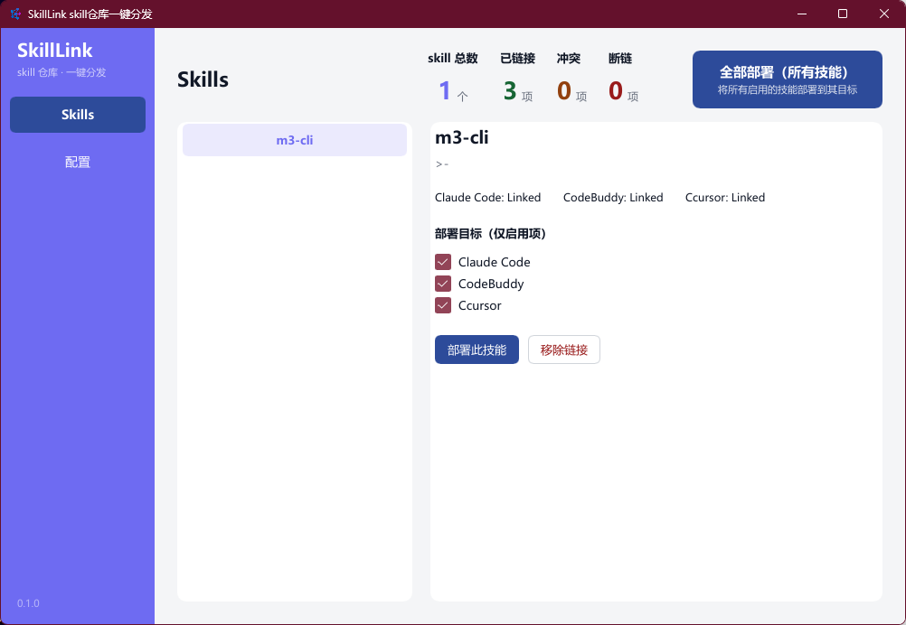
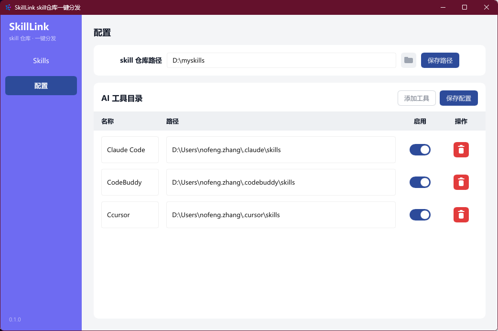

<div align="center">

# SkillLink — One-click agent skills distribution

**Keep all your AI coding tools' skills in one central repo, distribute them everywhere with Windows junctions.**

[](../../releases)
[](LICENSE)

[](https://gznofeng.github.io/SkillLink/)

简体中文 | [English](README.md)

</div>

---

One central **skills repo** (single source of truth), distributed to Claude Code, CodeBuddy, Codex,
Cursor, Gemini CLI and OpenCode via **Windows junctions** (`mklink /J`, no admin rights needed).

Pure Rust + [Slint](https://slint.dev) native UI — **a single exe with zero runtime dependencies**
(no WebView2, no .NET). Windows 10/11 x64, unzip and run.

## Screenshots

**Skills** — skill list on the left, four-state link status + checkbox deploy on the right:



**Config** — central repo path and AI tool directories:



## Features

### Config
- **Skills repo path**: set the central repo directory (type it or pick via folder dialog)
- **AI tool directories**: add / edit / enable / disable targets, with built-in defaults for mainstream tools
- Persisted at `%USERPROFILE%\.skill-client\config.json`

### Skills
- Auto-scans every direct subdirectory containing a `SKILL.md`, parses `name` / `description` frontmatter
- Per skill × per target link status detection:

| Status | Meaning |
|--------|---------|
| NotLinked | Skill not present in the target directory |
| Linked | A junction pointing to the central repo's skill |
| Conflict | A real directory/file exists at the target |
| Broken | A link whose destination is missing |

- **Deploy**: creates the junction; on conflict the existing directory is backed up as `xxx.bak` first
- **Remove link**: deletes only the junction itself — never touches real directories
- **Deploy all**: every skill × every enabled target, one click

## Download

[](https://github.com/gznofeng/SkillLink/releases/download/v0.1.0/SkillLink-v0.1.0-win64.zip)

Direct link: **[SkillLink-v0.1.0-win64.zip](https://github.com/gznofeng/SkillLink/releases/download/v0.1.0/SkillLink-v0.1.0-win64.zip)** — unzip, double-click `skill-link.exe`. More versions on the [Releases](../../releases) page.

Project homepage: **https://gznofeng.github.io/SkillLink/**

## Build from source

Requires Rust 1.85+ (2024 edition).

```powershell
git clone https://github.com/gznofeng/SkillLink.git
cd SkillLink2

# run in dev mode
cargo run -p skill-link-app

# package (version auto-read from app/Cargo.toml, output goes to release/)
powershell -File scripts\package.ps1
```

## Packaging script

`scripts/package.ps1` does the following:

1. `cargo build --release` (LTO + strip)
2. Assembles `skill-link.exe` + `使用说明.txt` into `package/SkillLink-v<version>/`
3. Compresses into `release/SkillLink-v<version>-win64.zip` (versioned archive, history kept)

To cut a release: bump `version` in `app/Cargo.toml` → run the script → upload the zip from `release/`.
Alternatively, just push a `v*` tag — [GitHub Actions](.github/workflows/release.yml) builds and
publishes the Release automatically.

## Project layout

```
├── app/            # Slint native UI desktop app
│   ├── src/main.rs        # app layer (models, callbacks, dialogs)
│   └── ui/app.slint       # UI definition
├── core/           # core logic (pure Rust lib, UI-agnostic, fully unit-tested)
│   └── src/
│       ├── config.rs      # config read/write (~/.skill-client/config.json)
│       ├── links.rs       # junction 4-state detection / deploy / remove / bulk
│       └── skills.rs      # skill scanning & frontmatter parsing
├── scripts/package.ps1    # packaging script
├── screenshot/            # UI screenshots (referenced by README)
├── release/               # versioned release archives (generated, not committed)
└── package/使用说明.txt    # usage notes shipped with the zip
```

## Design notes

- **Safety**: `unlink` deletes the junction only via `fs::remove_dir`; real directories are refused;
  the central repo is never touched
- **Conflict policy**: on deploy, existing real directories are renamed to `.bak` (timestamped on collision)
- **Junction creation**: `cmd /c mklink /J` with per-argument passing (quoting handled by std);
  cmd's GBK output is decoded to avoid mojibake
- **Icon**: `icon.ico` embedded into the exe resources via `winresource`; window icon from `ui/icon.png`
- **Rendering**: Slint software renderer (`winit-software`) — good text antialiasing, no GPU required

## Out of scope

- macOS / Linux support
- skill content editor, online install (placeholder), auto-update, code signing

## License

[MIT](LICENSE)
